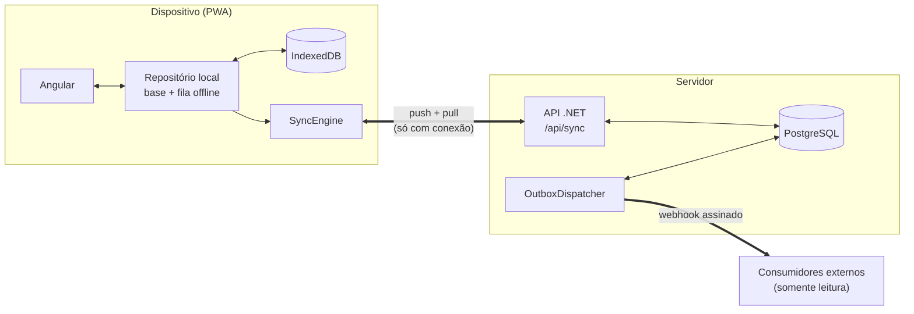

# Campo — Todo List Offline-First

Desafio técnico Way2: aplicação de lista de tarefas que continua **totalmente funcional sem conexão**, sincroniza sozinha quando o sinal volta e propaga as alterações, em quase tempo real, para aplicações externas (somente leitura).

**Stack:** .NET 10 (ASP.NET Core) · PostgreSQL 17 · Angular 22 (PWA, signals) · IndexedDB · Docker Compose.

| | |
|---|---|
| Diagramas de arquitetura | [`docs/architecture.md`](docs/architecture.md) (visão geral · fluxo de sync offline · fluxo da integração externa) |
| Testes automatizados | 45 no backend (xUnit + PostgreSQL real) · 37 no frontend (Vitest) |
| Usuário de teste | `demo@way2.dev` / `Demo@1234` |



## Sumário

1. [Como executar](#1-como-executar)
2. [Decisões técnicas e trade-offs](#2-decisões-técnicas-e-trade-offs)
3. [Premissas](#3-premissas)
4. [Limitações e próximos passos](#4-limitações-e-próximos-passos)
5. [Testes](#5-testes)
6. [Uso de inteligência artificial](#6-uso-de-inteligência-artificial)
7. [Mapa dos requisitos do desafio](#7-mapa-dos-requisitos-do-desafio)

---

## 1. Como executar

### Pré-requisitos

- **Docker Desktop** (ou Docker Engine + Compose v2) — é só isso para rodar tudo.
- Só para desenvolver sem Docker nos serviços: **.NET SDK 10** e **Node 22**.

### Opção A — um comando (recomendada para avaliar)

```bash
docker compose up --build
```

Na primeira vez baixa as imagens e compila tudo (alguns minutos). Quando terminar:

| O que | URL |
|---|---|
| **Aplicação** (build de produção, com service worker) | http://localhost:8080 |
| **Consumidor externo simulado** (painel ao vivo) | http://localhost:5100 |
| API + documentação interativa (Scalar) | http://localhost:5080/scalar |
| PostgreSQL | `localhost:55432` (usuário/senha/banco: `todo`) |

Entre com **`demo@way2.dev` / `Demo@1234`** (há um botão "Preencher conta de demonstração" na tela de login) ou crie uma conta. Para parar: `docker compose down` (acrescente `-v` para apagar os dados).

> A porta do PostgreSQL é `55432` de propósito, para não colidir com um PostgreSQL já instalado na máquina.

### Opção B — desenvolvimento (API e Angular fora do Docker)

```bash
docker compose up -d db                                                    # só o banco
dotnet run --project backend/src/TodoOffline.Api --urls http://localhost:5080
dotnet run --project consumer/ExternalConsumer --urls http://localhost:5100   # outro terminal
cd frontend && npm ci && npm start                                         # outro terminal → http://localhost:4200
```

As migrations e o usuário de teste são criados automaticamente na subida da API. Em desenvolvimento (`ng serve`) o service worker fica desligado; para testar **recarregar a página sem rede** use a Opção A (build de produção).

### Roteiro de demonstração

1. **Offline.** Abra http://localhost:8080 e entre. No DevTools → *Network* → **Offline** (ou `docker compose stop api web`, ou o modo avião de um celular). A régua no topo fica **ocre: "Offline"**.
2. **Escrita offline.** Crie, edite, conclua e exclua tarefas. Tudo aparece na hora; cada tarefa com alteração ainda não enviada mostra um ícone de nuvem e a régua conta as "N pendentes". Pode **recarregar a página** — o app abre (service worker) e as tarefas continuam lá.
3. **Urgentes.** Crie uma tarefa com "urgente" no título ou na descrição (qualquer caixa, ex.: "URGENTE"): ela sobe ao topo na hora, com filete e etiqueta "Urgente", **mesmo offline**. Edite o texto e remova a palavra: ela volta ao lugar normal.
4. **Reconexão.** Volte para *Online*. A régua fica **azul "Sincronizando"** e depois **"Sincronizado"**; as pendências somem.
5. **Integração externa.** Em http://localhost:5100 os eventos (`todo.created`, `todo.updated`, `todo.deleted`) aparecem depois de reconciliados no servidor. Use **"Injetar falha (503)"** para ver o retry com backoff (`tentativa #2`, `#3`…) e a ordem preservada.
6. **Conflito.** Simule dois dispositivos com a mesma conta: dois **navegadores/perfis diferentes** (ou uma janela anônima) — abas do mesmo navegador compartilham o mesmo IndexedDB e, portanto, não são dois dispositivos. Coloque ambos offline, edite o **mesmo campo** da mesma tarefa em cada um e reconecte: vence a edição mais recente e o outro dispositivo recebe um aviso de conflito resolvido. Campos **diferentes** são mesclados.

---

## 2. Decisões técnicas e trade-offs

### Visão geral e dimensionamento

O desafio pede uma solução **bem dimensionada**. A decisão central foi **não distribuir o que não precisa ser distribuído**: um monólito ASP.NET Core stateless + um PostgreSQL. Não há broker de mensagens, cache distribuído, microsserviços nem tempo real via WebSocket.

**1000 usuários simultâneos — conta de guardanapo:**

- Cada cliente faz um *pull* barato a cada 20 s (mais um *push* logo após cada escrita): ~**50 req/s** de leitura em regime e picos de poucas dezenas de escritas/s. O pull é uma consulta por índice `(UserId, ServerSeq)` que devolve só o delta (normalmente vazio).
- Uma instância do Kestrel atende milhares de req/s; o PostgreSQL atende isso com folga num único nó. As escritas de **usuários diferentes não disputam lock** (o lock é por linha de usuário).
- A API não guarda estado em memória → escalar é subir mais instâncias atrás do nginx/LB. O dispatcher do outbox já foi desenhado para isso (`FOR UPDATE SKIP LOCKED` + lease).
- Gargalo previsível: o *polling*. A evolução natural (ver §4) é trocar por SSE/WebSocket "há novidades" e manter o pull como fallback.
- O app é offline-first: a carga *percebida* pelo servidor é menor que a de um app online, porque leituras acontecem no dispositivo.

Não houve teste de carga (fora de escopo); o dimensionamento acima é argumentado, não medido.

### Stack e por quê

| Camada | Escolha | Por quê |
|---|---|---|
| Backend | **ASP.NET Core / .NET 10** (Minimal APIs), EF Core + Npgsql | exigência do desafio; .NET 10 é LTS. Sem MediatR/CQRS: o domínio é pequeno, camadas extras seriam super-engenharia. Estrutura: `Domain` (regras puras, testáveis) · `Features` (Auth, Sync) · `Outbox` · `Infrastructure`. |
| Banco | **PostgreSQL 17** | transações e *row locks* (serialização por usuário), `jsonb` (relógios por campo, payload dos eventos), `FOR UPDATE SKIP LOCKED` (fila do outbox sem broker). Escala para 1000 usuários sem esforço. SQLite seria mais simples de rodar, mas serializa escritas e não demonstra o desenho de concorrência. |
| Frontend | **Angular 22** standalone, **signals**, zoneless | desejável no desafio. **Signals em vez de NgRx**: o estado é pequeno e local (um repositório + um estado de lista); signals dão reatividade granular com bem menos código. Sem Angular Material/Tailwind: o design é próprio (tokens CSS + SCSS), o que também mantém o bundle em ~77 kB transferidos. |
| Armazenamento local | **IndexedDB** via [`idb`](https://github.com/jakearchibald/idb) | `idb` é só um *wrapper* de promessas sobre o IndexedDB (6 kB) — **toda a lógica de sync é nossa**. Evitei PouchDB/RxDB/Replicache/Firebase justamente porque o enunciado pede entender a sincronização por dentro. |
| Offline do app | **Service worker do Angular (`@angular/service-worker`)** | só faz cache do *app shell* (HTML/JS/CSS/fontes) para o app abrir sem rede. **Não** toca em dados nem em `/api`. |
| Fontes | `@fontsource` (IBM Plex Sans e IBM Plex Mono) | empacotadas no build: funcionam offline (nada de CDN). |
| Auth | **JWT** + senhas com **PBKDF2-SHA256** (120 mil iterações, salt aleatório) | autenticação simples (permitido); sem ASP.NET Identity (traria tabelas e fluxos que o enunciado dispensa). |
| Infra | **Docker Compose** (db, api, consumer, web/nginx) | `docker compose up --build` roda tudo. nginx serve o build e faz proxy de `/api` (mesma origem → sem CORS, e o service worker não intercepta a API). |
| Docs da API | **Scalar** (OpenAPI) | explorar os endpoints. |

### Mecanismo de sincronização

**Um único endpoint, `POST /api/sync`, faz *push* e *pull* numa ida e volta**: o cliente envia a fila de operações e o cursor, o servidor aplica as operações e devolve tudo que mudou desde o cursor.

**No dispositivo** (`frontend/src/app/core`):
- **Base + fila = visão.** O IndexedDB guarda (a) `todos`: o último estado **confirmado** pelo servidor e (b) `outbox`: as operações **pendentes**, em ordem. A UI lê `visão = base + operações pendentes aplicadas por cima`. Por isso toda escrita aparece instantaneamente, com ou sem rede, e a regra de urgentes/ordenação/filtros roda 100% local.
- **Toda escrita é local primeiro**, até online. A rede é só replicação — um único caminho de código para online e offline.
- **Fila com coalescência:** várias edições da mesma tarefa viram uma operação (menos tráfego ao reconectar); criar e excluir offline antes de qualquer envio cancela tudo (o servidor nunca soube da tarefa). Operações *em voo* nunca são mescladas (edições feitas durante o envio viram uma nova operação).
- **Commit atômico:** a resposta do servidor (remover operações confirmadas + atualizar a base + gravar o cursor) é aplicada numa **única transação do IndexedDB** — um crash no meio não deixa estado inconsistente nem perde fila.
- **Gatilhos:** ao abrir, evento `online`, após cada escrita (agrupando rajadas, 300 ms), ao voltar para a aba, a cada 20 s e pelo botão "Sincronizar".
- **Falhas:** *timeout* de 15 s (evita ficar preso em "Sincronizando" numa conexão pendurada — o cenário "lie-fi", em que `navigator.onLine` mente), erro de rede e 502/503/504 → **Offline**; outros erros → **Falha ao sincronizar**; 401 → **Sessão expirada** (o app segue funcionando). Retentativas com backoff exponencial (5 s → 60 s). Reenviar um lote é seguro porque o servidor é idempotente.
- **Indicador de estado** (régua no topo, sempre visível): **Offline** (ocre) · **Sincronizando** (azul-aço, ícone girando) · **Sincronizado** (ardósia com indicador verde) · **Falha** / **Sessão expirada** (vermelho). Cada alteração pendente é um "tique" na régua, e cada tarefa não confirmada mostra um ícone de nuvem.

**No servidor** (`backend/src/TodoOffline.Api`):
- **Cursor por usuário.** Cada alteração recebe `ServerSeq` = `++User.SyncSeq`. O contador é incrementado **sob lock de linha do usuário** (`UPDATE … SET SyncSeq = SyncSeq` no início da transação), o que serializa as escritas do mesmo usuário e garante que *a ordem do contador é a ordem de commit*. Resultado: um `pull` com `ServerSeq > cursor` **nunca pula** uma alteração (o problema clássico de usar sequence global com transações que commitam fora de ordem).
- **Tombstones.** Exclusão é lógica (`DeletedAt`) para poder ser propagada a outros dispositivos; o pull entrega o tombstone e o cliente apaga localmente.
- **Validação no servidor** (título obrigatório ≤ 200, descrição ≤ 4000, datas, enums). Uma operação inválida é **recusada sem derrubar o lote** e o cliente é avisado.
- **Isolamento:** uma operação cujo `id` já pertence a outro usuário é recusada (e nunca vaza dados).
- O endpoint `GET /api/todos` expõe a mesma listagem (filtros + ordenação) para depuração/integrações.

### Tratamento de conflitos (a mesma tarefa alterada em mais de um lugar)

Estratégia: **registrador LWW (*last-writer-wins*) por campo**, usando o **instante em que o usuário fez a edição** (não o instante em que chegou ao servidor).

- Cada tarefa guarda, para cada campo, o instante da última edição aceita (`fieldTimes`, `jsonb`). Uma operação envia **só os campos que o usuário tocou**, cada um com o seu instante.
- **Campos diferentes não conflitam:** celular altera a descrição e o desktop altera a prioridade → os dois valem.
- **Mesmo campo:** vence o de maior instante. Ex.: o celular editou o título às 10:00 offline e só reconectou às 18:00; o desktop editou às 14:00 → o título do desktop permanece (a edição antiga não "atropela" a nova só por ter chegado depois). O perdedor é informado em `rejectedFields` e a UI mostra *"Conflito resolvido: sua edição de título foi substituída por uma mais recente"*. Empate exato de instante é resolvido deterministicamente pelo valor.
- **Exclusão vence:** depois de excluída, edições posteriores são descartadas e a tarefa não "ressuscita".
- **Propriedades:** o merge é **comutativo e idempotente** — a ordem e a repetição das mensagens não alteram o resultado. Por isso o mesmo algoritmo roda no servidor (`TodoMerger.cs`) e no cliente (`merge.ts`) e os dois **convergem**; reenvios da fila após um timeout são inofensivos.
- **Relógio do dispositivo:** o instante enviado é limitado ao instante de recebimento do servidor (um relógio adiantado não consegue "vencer para sempre"), e o cliente adota o estado do servidor assim que não há operações pendentes sobre a tarefa. Um dispositivo é monotônico consigo mesmo (`nextAt()` nunca repete nem volta).
- **Por que não CRDT/OT, nem "última versão da tarefa inteira"?** Tarefa inteira perderia edições legítimas em campos distintos; CRDT de texto (edição colaborativa caractere a caractere) é desproporcional — o desafio exclui colaboração em tempo real. LWW por campo é o ponto de equilíbrio: simples de explicar, de testar e sem perda silenciosa nos casos comuns.
- **Trade-off assumido:** duas edições *do mesmo campo* feitas em lugares diferentes → uma é descartada (com aviso). Não há tela de "resolver manualmente".

### Regra das tarefas urgentes e ordenação

- **Regra:** o título **ou** a descrição contém `urgente`, **sem diferenciar maiúsculas/minúsculas** (`Urgente`, `URGENTE`, `urgente`). Implementada **duas vezes com o mesmo contrato** — `UrgentRule.cs` (servidor) e `urgent-rule.ts` (dispositivo) — e validada pelos **mesmos vetores de teste** (`shared/urgent-rule-cases.json`) nos dois lados, garantindo paridade online/offline.
- **Funciona offline:** o cálculo é feito no dispositivo, sobre a visão local (base + fila). Criou ou editou uma tarefa passando a conter "urgente" → ela sobe **imediatamente**, sem servidor. O servidor recalcula e persiste `IsUrgent` (usado nos eventos externos e em `GET /api/todos`).
- **Urgentes ficam no topo sempre**, acima das demais, **inclusive com filtros/busca ativos** e mesmo se concluídas (leitura literal do enunciado). Na tela aparecem numa seção própria "Urgentes", com filete lateral e etiqueta "Urgente".
- **Critério de ordenação padrão** (dentro das urgentes e dentro das demais), idêntico no servidor e no cliente:
  1. **pendentes antes de concluídas**;
  2. **prioridade** alta → média → baixa;
  3. **vencimento** mais próximo primeiro (sem data por último);
  4. **mais recentes** primeiro (data de criação);
  5. `id` como desempate estável.

  *Justificativa:* o que exige ação vem antes; entre o que exige ação, a mais importante e a mais próxima do prazo vêm primeiro. É um critério determinístico, então a lista não "pula" depois da sincronização.

### Integração com aplicações externas

Técnica: **Transactional Outbox + webhooks assinados** (push HTTP), com um *dispatcher* em segundo plano. Desenho completo e diagrama em [`docs/architecture.md`](docs/architecture.md#3-fluxo-da-integração-externa).

- **Só depois de reconciliado:** o evento é gravado **na mesma transação** da mudança, dentro do `POST /api/sync`. O dispositivo nunca fala com os consumidores — uma alteração feita offline só é propagada depois de chegar e ser aceita pelo servidor.
- **Quase tempo real:** logo após o commit a API "acorda" o dispatcher (canal em memória) → latência de milissegundos. Um *polling* de 1 s continua como rede de segurança (reinícios, retries agendados, outras instâncias).
- **Eventos:** `todo.created`, `todo.updated`, `todo.deleted`. Payload com `eventId`, `occurredAt`, `ownerId`, `aggregate {type, id, version}` e **snapshot completo** da tarefa (o consumidor faz *upsert* idempotente; não precisa reconstruir diffs). Só são emitidos eventos para mudanças **reais** (replays/noops/rejeitadas não geram eventos).
- **Consumidores (somente leitura):** cadastrados por configuração (`Webhooks:Subscribers` — nome, URL, segredo). Cada evento gera **uma entrega por consumidor ativo**, então consumidores são independentes entre si. Os consumidores só recebem; não existe caminho de escrita de volta.
- **Garantias de entrega:**
  - **At-least-once**: só é marcado `Delivered` depois de um 2xx; se o processo cair entre o 2xx e o registro, reenvia (duplicata possível).
  - **Idempotência**: `X-Event-Id` estável + `aggregate.version` crescente. O consumidor de exemplo deduplica por `eventId` e ignora versões ≤ à já projetada.
  - **Ordem**: por consumidor **e por tarefa**. Uma entrega só é elegível se não houver outra anterior pendente da mesma tarefa para o mesmo consumidor. Tarefas diferentes seguem em paralelo (ordem global entre tarefas não é necessária e custaria vazão).
  - **Retry com backoff exponencial + jitter** (2 s, 4 s, 8 s… teto de 5 min), com *timeout* de 5 s por requisição.
  - **Falha do consumidor:** cada consumidor falha isoladamente — um consumidor fora do ar acumula pendências **só dele**. Após **8 tentativas** a entrega vira `Dead` (dead-letter), guarda o último erro e libera o próximo evento da tarefa (o snapshot completo mantém o consumidor consistente mesmo assim).
  - **Autenticidade:** `X-Signature: sha256=<HMAC-SHA256(segredo, corpo)>`.
  - **Escala horizontal:** o *claim* usa `FOR UPDATE SKIP LOCKED` + *lease* (`LockedUntil`); várias instâncias do dispatcher não pegam a mesma entrega.
- **Por que não Kafka/RabbitMQ?** Para este volume o próprio PostgreSQL como fila (outbox) entrega as garantias necessárias e elimina um componente inteiro para operar. **Por que não publicar direto na requisição?** Se o consumidor estivesse lento/fora do ar, o *sync* do usuário também ficaria — e uma queda entre "gravei" e "publiquei" perderia o evento (*dual write*).
- **Consumidor simulado** (`consumer/ExternalConsumer`): API mínima que valida a assinatura, deduplica, projeta o estado e mostra tudo num painel em tempo real (http://localhost:5100), com um botão para **injetar falhas** e demonstrar retry/backoff.

### Autenticação e segurança

JWT (7 dias — longo de propósito: uso em campo, possivelmente dias sem conexão; ver §4 sobre *refresh tokens*), PBKDF2, mensagem única para "usuário inexistente" e "senha errada", e **isolamento por usuário** em todo acesso a dados (o `userId` vem sempre do token, nunca do corpo da requisição). Offline, o app abre com a sessão salva — o token só é exigido na sincronização. O banco local é **um por usuário** (`campo:<userId>`): trocar de conta não mistura dados e nunca perde a fila pendente de quem saiu (sair com pendências pede confirmação).

### Interface (UI/UX)

Visual sóbrio de ferramenta corporativa: cinzas-ardósia neutros, azul-aço para foco/ações e cores de estado escuras e discretas (sem gradientes, brilhos nem efeitos). A única cor "quente" fixa é o tijolo, reservado à urgência. O estado da conexão é parte da interface: a **régua de sincronização** no topo (cor = estado, tiques = pendências) e a **prioridade como barras de sinal**. Tipografia IBM Plex Sans/Mono, empacotada no build. Mobile-first: no celular o campo de adicionar fica ao alcance do polegar, o editor vira *bottom sheet* e as listas viram uma gaveta. Foco visível, contraste AA nas barras de estado, `prefers-reduced-motion` respeitado.

---

## 3. Premissas

1. **Agrupamento = "Listas"**: uma lista é a **categoria** (texto) atribuída à tarefa; as listas existem enquanto houver tarefas nelas (não há entidade "lista vazia"). Escolhi isso para o agrupamento também funcionar offline sem dependência entre entidades (uma tarefa nunca referencia uma lista que o servidor ainda não conhece).
2. **"Contém a palavra urgente"** foi interpretado como **contém a sequência `urgente`, ignorando maiúsculas/minúsculas**. Logo "urgentemente" e "urgentes" também disparam. É uma constante única nos dois lados (`UrgentRule.cs` / `urgent-rule.ts`) e trocar para "palavra inteira" é uma linha mais um vetor de teste. Não ignoro acentos (não existe "urgênte" em português).
3. **Urgentes concluídas** continuam no topo (leitura literal: "toda tarefa urgente … no topo"). Quem não quiser vê-las usa o filtro "Pendentes".
4. **Ordenação entre urgentes** = a mesma ordenação padrão da lista (definida acima).
5. **Primeiro login precisa de internet** (a autenticação é no servidor). Depois, o app abre e funciona offline com a sessão salva.
6. **Cadastro simples**: sem verificação de e-mail e sem recuperação de senha (fora de escopo). Há um usuário de teste e um formulário de cadastro.
7. **Exclusão é definitiva e vence edições concorrentes**; não há "desfazer" nem lixeira.
8. **Relógios dos dispositivos** são razoavelmente corretos (celulares sincronizam por rede). Relógio adiantado é contido pelo limite do servidor (ver "Conflitos").
9. **Consumidores externos** são configurados por arquivo/variáveis de ambiente (não há tela de cadastro) e recebem **todos** os eventos de **todos** os usuários, com `ownerId` no payload.
10. **Segredos de desenvolvimento** (chave do JWT, segredo do webhook, senha do banco) estão no repositório por conveniência; em produção vêm de variáveis de ambiente/secret manager.
11. Alvo: navegadores modernos (Chrome/Edge/Safari/Firefox atuais). O service worker e o recarregamento offline foram verificados no Chrome; os demais navegadores não foram testados.

---

## 4. Limitações e próximos passos

**O que ficou de fora / limitações conhecidas**

- **Atualização entre dispositivos por polling (20 s).** Funciona, mas não é instantâneo. *Como faria:* um endpoint SSE (`/api/sync/stream`) que só avisa "há mudanças" (o cliente então faz o pull de sempre), com o polling como fallback. Mantém o desenho simples e tira o gargalo previsível dos 1000 usuários.
- **Sem *refresh token***. O JWT dura 7 dias. *Como faria:* access token curto + refresh token rotativo (com revogação), e renovação silenciosa no `SyncEngine`.
- **Várias abas do mesmo navegador** compartilham o IndexedDB, mas não se avisam em tempo real (não há `BroadcastChannel`/Web Locks): cada aba converge pelo servidor no próximo ciclo (≤ 20 s). O reenvio de operações é idempotente, então não há duplicação. *Como faria:* `BroadcastChannel` para refletir a fila entre abas e Web Locks para eleger uma única aba como a que sincroniza.
- **Sem Background Sync API.** Alterações pendentes só são enviadas com o app aberto. *Como faria:* registrar um *sync event* no service worker para enviar a fila com o app fechado (Chrome/Android).
- **Dead-letter sem ferramenta de reprocessamento** (fica registrado no banco com o último erro). *Como faria:* endpoint administrativo para listar/reenfileirar, métricas (profundidade da fila, idade do evento mais antigo, taxa de falha) e alertas.
- **Crescimento de dados:** tombstones e eventos entregues não são purgados. *Como faria:* job de retenção (ex.: tombstones > 90 dias só após todos os dispositivos terem passado do cursor; eventos `Delivered` > 7 dias).
- **Sem limitação de taxa (*rate limiting*) em login/sync**, sem HTTPS/HSTS embutidos (esperado atrás de um proxy TLS).
- **Conflitos no mesmo campo descartam uma das edições** (com aviso). *Próximo passo:* guardar a versão perdida e oferecer "restaurar" na UI.
- **Dados locais não são criptografados** (IndexedDB em texto claro, como qualquer PWA). Aceitável para tarefas; para dados sensíveis, cifrar com chave derivada do login.
- **Testes de ponta a ponta (Playwright) e de componentes Angular não foram escritos.** O comportamento ponta a ponta foi validado manualmente (roteiro do §1) e a lógica crítica tem testes automatizados (§5). *Como faria:* um E2E que desliga a rede (`context.setOffline`), cria tarefas e verifica sync + evento no consumidor.
- **Listas longas:** a UI renderiza todas as tarefas filtradas. Para milhares de itens, *virtual scroll* (`@angular/cdk`).
- **Dispatcher multi-instância** foi desenhado para isso (SKIP LOCKED + lease), mas só foi testado com uma instância.
- **Acessibilidade:** teclado/foco/rótulos ARIA cuidados, mas sem auditoria formal nem teste com leitor de tela.
- **Sem teste de carga** (fora de escopo): o dimensionamento é argumentado (§2), não medido.

**Com mais tempo:** SSE, refresh tokens, Background Sync, painel de dead-letter, E2E, virtual scroll, histórico de versões por tarefa e resolução manual de conflitos.

---

## 5. Testes

```bash
# Backend — precisa de Docker (sobe um PostgreSQL descartável via Testcontainers)
dotnet test backend

# Frontend — Vitest + IndexedDB falso (fake-indexeddb)
cd frontend && npm ci && npm test -- --watch=false
```

**Backend (45 testes, PostgreSQL 17 real — nada de banco em memória, porque o sync usa locks, `jsonb` e `SKIP LOCKED`):**
- **Regra de urgentes:** vetores compartilhados com o frontend (case-insensitive, descrição, pontuação, nulos…).
- **Merge / conflitos:** campos distintos mesclam; mesmo campo vence o instante mais recente **independente da ordem de chegada**; comutatividade e idempotência; empate determinístico; remoção "sticky"; validação atômica; relógio no futuro limitado.
- **Ordenação padrão:** urgentes no topo (mesmo concluídas/baixa prioridade) e critérios internos.
- **Sync (HTTP):** exige autenticação; criação offline puxada por outro dispositivo; isolamento entre usuários e *hijack* de id; merge de campos distintos; conflito no mesmo campo com aviso; **reenvio do mesmo lote é idempotente**; tombstones; operação inválida não derruba o lote; paginação do pull com cursor.
- **Outbox:** versões e tipos dos eventos em ordem; replays/noops/rejeições **não** geram evento; entrega com assinatura HMAC válida; **retry com backoff** respeitando a ordem por tarefa (outra tarefa não é afetada); **dead-letter** após o máximo de tentativas liberando o próximo evento.

**Frontend (37 testes):** regra de urgentes (mesmos vetores), merge LWW, *overlay* base+fila, ordenação e filtros/busca (sem acento, por lista), e o **ciclo offline→online**: escrita sem nenhuma chamada de rede, urgente offline subindo ao topo, coalescência da fila, criar+excluir offline sem envio, envio ao reconectar com confirmação, falha de rede mantendo a fila, edição durante o envio não se perde, tombstone apagando localmente e aviso de conflito.

---

## 6. Uso de inteligência artificial

Usei o **Claude Code (Claude Sonnet 5.5, Anthropic)** como assistente de programação ao longo de todo o desenvolvimento: ele ajudou a levantar a arquitetura, escrever o código (backend, frontend, consumidor, Docker), os testes e este README, e a depurar problemas encontrados ao rodar o sistema de verdade (por exemplo: colisão de porta com um PostgreSQL local, conexão "pendurada" mantendo o app em "Sincronizando", Enter não enviando o formulário). As decisões de escopo e de arquitetura foram revisadas e são minhas; **entendo e sei defender cada trecho do código e cada decisão aqui descrita**.

Nenhuma biblioteca "pronta" resolve o centro do desafio: a sincronização offline (fila, merge, cursor, outbox) é código próprio deste repositório.

---

## 7. Mapa dos requisitos do desafio

| # | Requisito | Onde está |
|---|---|---|
| 1 | Autenticação, cada usuário só vê as próprias tarefas | `Features/Auth`, JWT; `userId` sempre do token; teste de isolamento |
| 2 | CRUD com título*, descrição, vencimento, prioridade, status | `TodoMerger.cs` (validação) · `task-editor.component.ts` · composer |
| 3 | Agrupamento | Listas (categorias) — sidebar e campo "Lista" |
| 4 | Concluir / reabrir | checkbox da linha · `TodoRepository.toggle` |
| 5 | Filtrar / buscar | `filter-bar.component.ts` · `todo-query.ts` (status, prioridade, texto sem acento, lista) |
| 6 | **Urgentes no topo, case-insensitive, vale offline** | `urgent-rule.ts` / `UrgentRule.cs` + vetores compartilhados; `compareTodos` |
| 7 | **Offline no celular**, persistência local, sync automático, indicador de estado | IndexedDB + fila · `SyncEngine` · `sync-rail.component` · PWA |
| 8 | Integração externa (push, quase tempo real, só leitura, só após reconciliar) | Outbox + `OutboxDispatcher` + `consumer/ExternalConsumer` |
| — | Backend .NET · Angular desejável · infra justificada | §2 |
| — | Diagramas · README · testes | `docs/architecture.md` · este arquivo · §5 |
