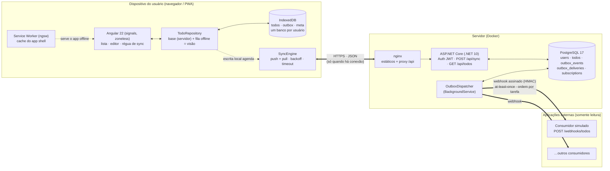
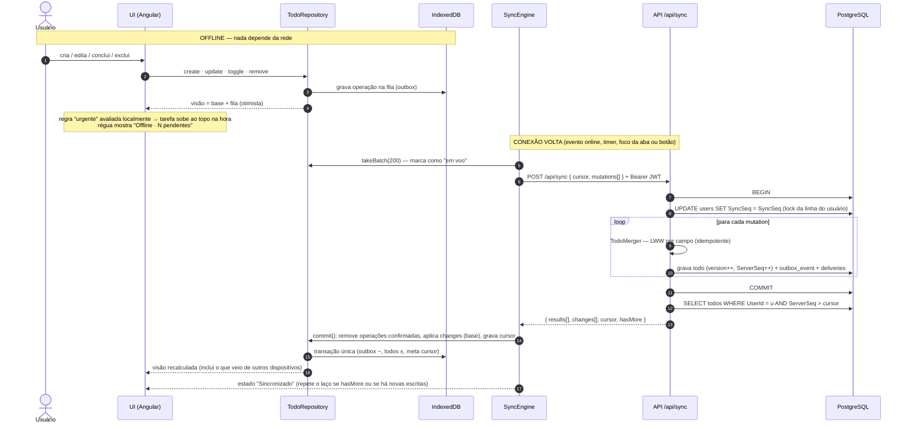
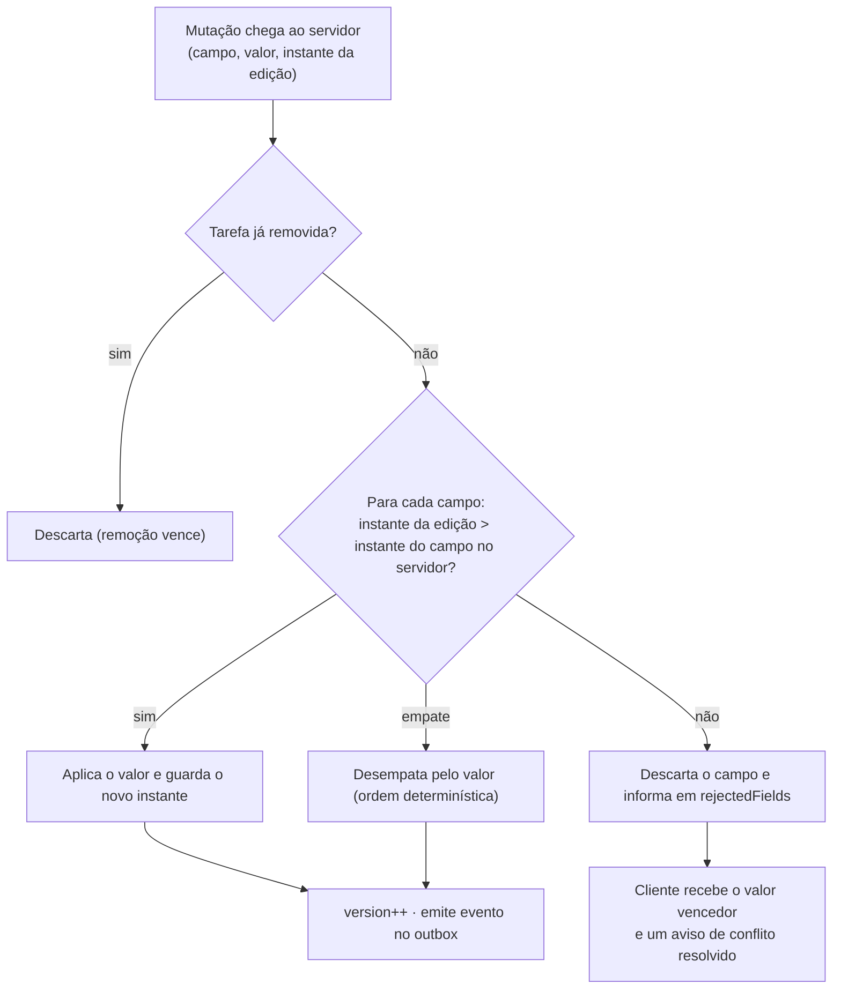

# Arquitetura

Diagramas em [Mermaid](https://mermaid.js.org/) (renderizam direto no GitHub). Três visões, como pedido no desafio:
1. [Visão geral](#1-visão-geral) — componentes, onde cada um roda e como se comunicam.
2. [Fluxo da sincronização offline](#2-fluxo-da-sincronização-offline) — da gravação local no dispositivo até a reconciliação no servidor.
3. [Fluxo da integração externa](#3-fluxo-da-integração-externa) — do servidor até os consumidores.

---

## 1. Visão geral



| Componente | Onde roda | Responsabilidade |
|---|---|---|
| **Angular (PWA)** | navegador do usuário | UI, estado local, regra de urgentes, fila offline, motor de sync |
| **IndexedDB** | navegador do usuário | persistência local: estado confirmado (`todos`), fila (`outbox`), cursor (`meta`) |
| **Service Worker** | navegador do usuário | guarda o *app shell* para o app abrir sem rede |
| **nginx** | container `web` | serve o build estático e faz proxy de `/api` para a API (mesma origem, sem CORS) |
| **API .NET** | container `api` | autenticação, reconciliação (`/api/sync`), outbox transacional |
| **OutboxDispatcher** | dentro do processo da API | entrega os eventos aos consumidores com retry/backoff |
| **PostgreSQL** | container `db` | fonte da verdade; também serve de fila (outbox) |
| **Consumidor simulado** | container `consumer` | recebe os webhooks, valida assinatura, deduplica, mostra num painel |

---

## 2. Fluxo da sincronização offline

Princípios: **toda escrita vai primeiro para o dispositivo** (mesmo online) e a rede é só replicação. A UI nunca espera o servidor.



**Falhas:** timeout (15 s), erro de rede, 502/503/504 → estado *Offline*, fila intacta, nova tentativa com backoff (5 s → 60 s) e imediatamente ao receber o evento `online`. 401 → estado *Sessão expirada*: o app segue funcionando e pede novo login sem perder nada. Reenviar o mesmo lote é seguro (o merge é idempotente).

### Resolução de conflitos (mesma tarefa alterada em mais de um lugar)



Campos diferentes nunca conflitam (são mesclados). O mesmo algoritmo roda no servidor (`TodoMerger.cs`) e no dispositivo (`merge.ts`), por isso os dois convergem.

---

## 3. Fluxo da integração externa

A propagação só começa **depois** que a alteração foi reconciliada e commitada no servidor — nunca direto do dispositivo.

```mermaid
sequenceDiagram
  autonumber
  participant API as API (SyncService)
  participant PG as PostgreSQL
  participant D as OutboxDispatcher
  participant C as Consumidor externo

  Note over API,PG: mesma transação da mudança (Transactional Outbox)
  API->>PG: INSERT todo / UPDATE todo
  API->>PG: INSERT outbox_event (eventId, tipo, versão, payload)
  API->>PG: INSERT outbox_delivery (1 por consumidor ativo, status Pending)
  API->>D: sinal "há eventos novos" (após o commit) — latência de ms

  loop enquanto houver entregas elegíveis
    D->>PG: claim: UPDATE … SET LockedUntil WHERE Id IN (<br/>SELECT … Pending, vencida, sem entrega anterior<br/>pendente do mesmo agregado/consumidor<br/>FOR UPDATE SKIP LOCKED) RETURNING Id
    D->>C: POST /webhooks/todos<br/>X-Event-Id · X-Aggregate-Version · X-Signature (HMAC-SHA256)
    alt 2xx
      C-->>D: 200
      D->>PG: status = Delivered
    else falha ou timeout (5 s)
      C-->>D: 5xx / sem resposta
      D->>PG: attempts++ · NextAttemptAt = agora + backoff exponencial c/ jitter
      Note over D,PG: eventos seguintes da MESMA tarefa esperam; outras tarefas seguem
    else attempts ≥ MaxAttempts (8)
      D->>PG: status = Dead (dead-letter) → libera o próximo evento da tarefa
    end
  end

  Note over C: Consumidor: valida HMAC · deduplica por X-Event-Id ·<br/>ignora versão ≤ à já projetada
```

### Garantias de entrega

| Propriedade | Como é obtida |
|---|---|
| **Sem perda** | evento gravado na mesma transação da mudança; só vira `Delivered` após 2xx |
| **At-least-once** | se o processo cair entre o 2xx e o `UPDATE`, o evento é reenviado |
| **Idempotência** | `eventId` estável + `aggregate.version` → o consumidor ignora duplicatas e versões antigas |
| **Ordem** | por (consumidor, tarefa): uma entrega só é elegível se não houver outra anterior pendente da mesma tarefa |
| **Isolamento** | cada consumidor tem suas próprias entregas: um consumidor fora do ar não atrasa os demais |
| **Retry** | backoff exponencial (2 s, 4 s, 8 s… até 5 min) com jitter ±20 % |
| **Falha permanente** | após 8 tentativas a entrega vira `Dead`, fica registrada com o último erro e não bloqueia a fila |
| **Autenticidade** | `X-Signature: sha256=HMAC(secret, corpo)` |
| **Escala horizontal** | claim com `FOR UPDATE SKIP LOCKED` + lease (`LockedUntil`) — várias instâncias podem rodar o dispatcher |
